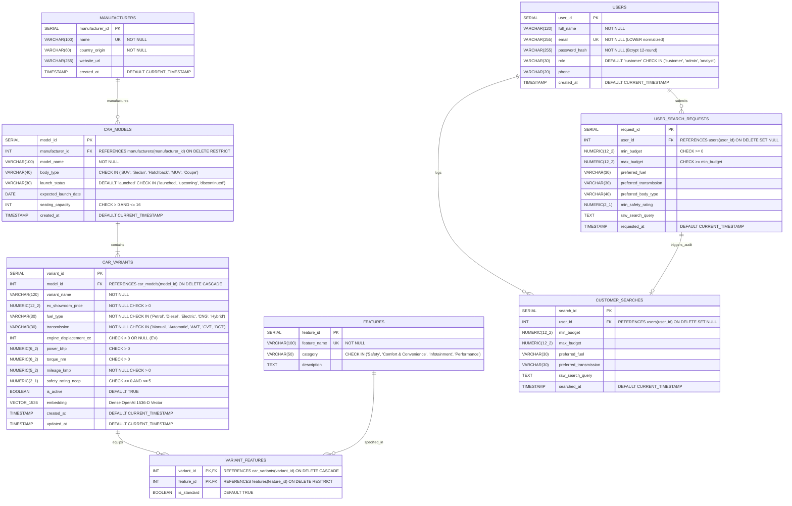

# Entity-Relationship (ER) Diagram & Relational Schema Architecture

**Project**: Car Recommendation Database Management System  
**Engine**: PostgreSQL 14+ with `pgvector` Extension  
**Course / Evaluation Target**: 50-Mark DBMS University Evaluation  

---

## 1. Formal Mermaid Entity-Relationship Diagram

This diagram reflects the exact database schema implemented in [`database/01_schema.sql`](../database/01_schema.sql) and [`database/02_vector_setup.sql`](../database/02_vector_setup.sql).

---

## 2. Relational Schema Architecture & Cardinality Analysis

### A. Manufacturer → Model → Variant Hierarchy
* **1-to-Many (`manufacturers` → `car_models`)**: One automaker (e.g., Tata Motors, Mahindra) designs multiple model lines (`Nexon`, `Curvv EV`, `XUV700`). Referential integrity uses `ON DELETE RESTRICT` to ensure a manufacturer cannot be deleted while vehicle models still reference it.
* **1-to-Many (`car_models` → `car_variants`)**: Each model line contains multiple trims with distinct powertrains and equipment levels. Referential integrity uses `ON DELETE CASCADE`, ensuring trim removal when a parent model line is purged.
* **Many-to-Many (`car_variants` ↔ `features`) via `variant_features`**:
  * Junction table using composite primary key `(variant_id, feature_id)`.
  * Accommodates equipment variance across trim ladders: base trims lack ADAS or panoramic sunroofs, whereas luxury trims include them as standard (`is_standard = TRUE`).

### B. User Activity & Search Auditing
* **1-to-Many (`users` → `user_search_requests`)**: Authenticated and guest search inputs are captured for preference mining. Uses `ON DELETE SET NULL` to preserve historical analytical data even if a user account is removed.
* **Database Trigger Synchronization (`trg_log_search`)**: Automatically propagates validated search criteria into `customer_searches` for administrative trend analysis.

---

## 3. Database Constraints & Data Integrity Matrix

| Table | Constraint Name | Type | Purpose |
| :--- | :--- | :--- | :--- |
| `users` | `uq_users_email` | UNIQUE | Prevents duplicate user registrations (case-insensitive normalized). |
| `users` | `chk_user_role` | CHECK | Restricts roles strictly to `customer`, `admin`, or `analyst`. |
| `car_models` | `chk_body_type` | CHECK | Ensures body styles adhere to valid automotive segments. |
| `car_models` | `chk_launch_status` | CHECK | Enforces launch progression (`launched`, `upcoming`, `discontinued`). |
| `car_variants` | `chk_price_positive` | CHECK | Rejects negative or zero prices (`ex_showroom_price > 0`). |
| `car_variants` | `chk_safety_rating` | CHECK | Restricts NCAP stars between `0.0` and `5.0`. |
| `car_variants` | `chk_fuel_type` | CHECK | Validates fuel powertrains against known market options. |
| `variant_features` | `pk_variant_features` | PRIMARY KEY | Composite key `(variant_id, feature_id)` prevents duplicate feature assignments. |
| `car_variants` | `idx_car_variants_hnsw` | HNSW INDEX | 1536-dimensional cosine distance vector index (`vector_cosine_ops`). |
